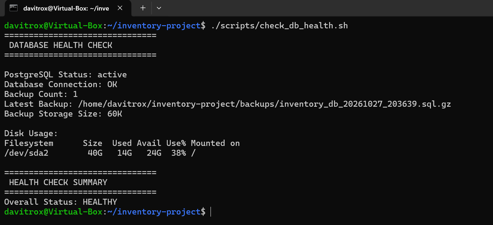
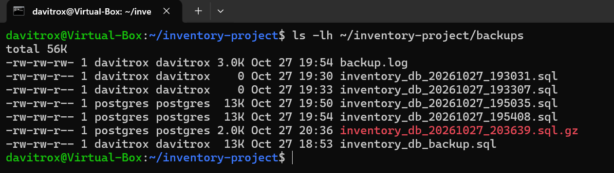
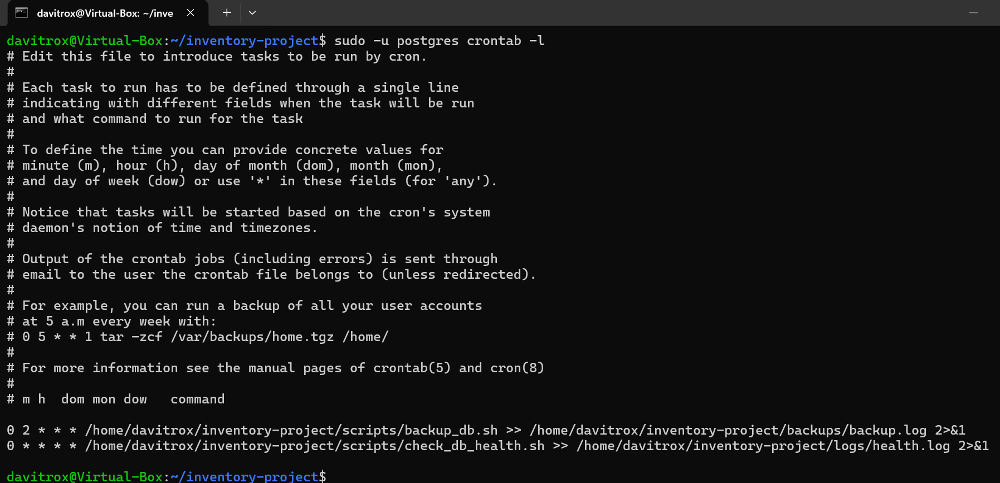
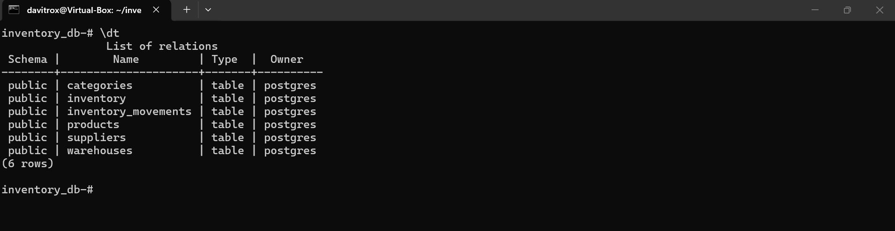

Automated Inventory Database Server

Version: 1.0

Status: Completed

A hands-on Linux and PostgreSQL project focused on database administration, backup automation, disaster recovery, and system management.

-----------------------------------------------------------------------------------------------------------------------


Project Overview

This project simulates a real-world inventory management environment running on Ubuntu Server with PostgreSQL.

The objective is to demonstrate:

* Linux system administration
* PostgreSQL database management
* Relational database design
* SQL Query Development
* Backup and recovery procedures
* Disaster Recovery
* Health Monitoring
* Bash scripting
* Cron job automation
* Git & GitHub Workflow

-----------------------------------------------------------------------------------------------------------------------


Technologies Used

* Ubuntu Server
* PostgreSQL
* Bash
* Cron
* Git
* GitHub

-----------------------------------------------------------------------------------------------------------------------

Key Features

Database Administration

* PostgreSQL deployment and configuration
* Relational database design
* Foreign key relationships
* SQL reporting queries

Inventory Management

* Product catalog
* Supplier management
* Warehouse management
* Inventory tracking
* Inventory movement history

Backup Automation

* Automated PostgreSQL backups
* Timestamped backup naming
* Compressed backup archives (.sql.gz)
* Scheduled execution using cron

Disaster Recovery

* Automated restore script
* Recovery procedures documentation
* Backup validation testing

Monitoring

* Database health monitoring
* PostgreSQL service validation
* Database connectivity checks
* Backup verification
* Disk utilization monitoring
* Health logging

Backup Retention

* Automatic cleanup of backup archives older than 7 days

-----------------------------------------------------------------------------------------------------------------------

System Architecture
See:

docs/system_architecture.md

-----------------------------------------------------------------------------------------------------------------------

Database ERD
See:

docs/ERD.md

-----------------------------------------------------------------------------------------------------------------------

Health Check

The project includes a custom health monitoring script.




-----------------------------------------------------------------------------------------------------------------------

Automated Backups

The system automatically generates compressed PostgreSQL backup archives.



-----------------------------------------------------------------------------------------------------------------------

Cron Automation

Scheduled tasks are executed automatically using cron.




-----------------------------------------------------------------------------------------------------------------------

PostgreSQL Database

Database tables and relationships.



-----------------------------------------------------------------------------------------------------------------------
Repository Structure

```text
inventory-project/
│
├── backups/
│
├── docs/
│   ├── database_schema.md
│   ├── ERD.md
│   ├── recovery_procedure.md
│   ├── system_architecture.md
│   └── screenshots/
│
├── logs/
│
├── scripts/
│   ├── backup_db.sh
│   ├── restore_db.sh
│   └── check_db_health.sh
│
├── sql/
│   ├── create_tables.sql
│   ├── sample_data.sql
│   ├── database_design.md
│   └── business_queries.sql
│
└── README.md
```
-----------------------------------------------------------------------------------------------------------------------

Example SQL Reports

Included reporting queries:

* Inventory by warehouse
* Low stock products
* Inventory valuation
* Total inventory value
* Inventory movement history

Location:

sql/business_queries.sql

-----------------------------------------------------------------------------------------------------------------------
Learning Outcomes

Through this project I practiced:

* Linux Server Administration
* PostgreSQL Management
* SQL Query Development
* Bash Scripting
* Cron Job Scheduling
* Backup Automation
* Disaster Recovery
* Monitoring and Health Checks
* Git Version Control
* Technical Documentation

-----------------------------------------------------------------------------------------------------------------------
Future Improvements

* Email alerts
* Backup verification automation
* Role-based database security
* Docker deployment
* Monitoring dashboard
* Database replication

-----------------------------------------------------------------------------------------------------------------------
Author

David

Linux • PostgreSQL • SQL • Bash
